# G1 SONIC desk: datasets, training and evaluation

A Unitree G1 picks up an apple and places it on a plate, on a simulated copy of a real office desk. This report covers eight datasets of that task, labelled for GR00T N1.7 driving NVIDIA's SONIC v1.1 whole-body controller, and a GR00T N1.7 policy trained and evaluated on the same desk.


| | |
| --- | --- |
| Datasets | 8 looks and layouts, 1,296 episodes, LeRobot v2.1 |
| Policy | GR00T N1.7 fine-tuned for `UNITREE_G1_SONIC`: from the head camera, the robot's state and the instruction, it outputs SONIC v1.1 motion tokens and Dex3 hand targets |
| Training layout | 190 of 200 placed (95%) |
| Apple and plate 12 cm outside the training layout | 69 of 100 placed (69%) |
| Light, camera, clutter, noise and instruction changes | 92 to 96 of 100 placed, against 98 for the baseline |
| Apple mass, friction and surface changes | 99 to 100 of 100 placed, against 99 for the baseline |
| Falls | none in any test |

## Datasets

The datasets start from NVIDIA's [Arena-G1-Static-PickNPlace-Task](https://huggingface.co/datasets/nvidia/Arena-G1-Static-PickNPlace-Task) demos, which use a different controller (AGILE) and a different scene. Each episode follows one of those demos: in `baseline`, the wrists are a median 0.8 cm (left) and 1.0 cm (right) from the demo relative to the pelvis, the arm joints are within about 2.6 degrees, and neither foot lifts or slides more than 2 cm. `reference.arena_state` holds NVIDIA's joints for every frame, so you can compare for yourself. The `positions` dataset differs from the demos on purpose.

[Watch all ten looks playing together](docs/preview.mp4), at half speed. They show one of the cleanest episodes, so the apple lands more gently than in a typical one. NVIDIA's demos move fast at their real 50 Hz, and the datasets keep that speed.

| Dataset | What it changes | Episodes |
| --- | --- | --- |
| [`g1-sonic-desk-apple-baseline`](https://huggingface.co/datasets/kiteml/g1-sonic-desk-apple-baseline) | The reference look, with lighting matched to a photo of the real desk. | 162 |
| [`g1-sonic-desk-apple-evening`](https://huggingface.co/datasets/kiteml/g1-sonic-desk-apple-evening) | Dim, warm light from a low ceiling source. The darkest look in the set. | 162 |
| [`g1-sonic-desk-apple-fluorescent`](https://huggingface.co/datasets/kiteml/g1-sonic-desk-apple-fluorescent) | Cool overhead light with soft shadows. | 162 |
| [`g1-sonic-desk-apple-window`](https://huggingface.co/datasets/kiteml/g1-sonic-desk-apple-window) | Low, hard side light with long shadows across the desk and plate. | 162 |
| [`g1-sonic-desk-apple-rearranged`](https://huggingface.co/datasets/kiteml/g1-sonic-desk-apple-rearranged) | The desk's own items (keyboard, mouse, eraser, spray bottle, wipes, small bottle) moved to new spots. | 160 |
| [`g1-sonic-desk-apple-tools`](https://huggingface.co/datasets/kiteml/g1-sonic-desk-apple-tools) | New objects on the desk: stapler, pliers, measuring tape and alarm clock. | 161 |
| [`g1-sonic-desk-apple-types`](https://huggingface.co/datasets/kiteml/g1-sonic-desk-apple-types) | Four apples, varied by episode: the original, a green one, a yellow one and a scanned real apple. The motions are the same as in the other datasets. | 162 |
| [`g1-sonic-desk-apple-positions`](https://huggingface.co/datasets/kiteml/g1-sonic-desk-apple-positions) | The apple starts up to 5 cm from its original spot, and the motion is adapted to reach it. These motions deliberately differ from NVIDIA's demos. | 165 |

All are LeRobot v2.1 at 50 fps, with one 640 x 480 head camera. `rearranged` and `tools` have fewer episodes because they leave out those where an arm comes within 5 cm of an object.

| Key | Shape | Content |
| --- | --- | --- |
| `observation.images.ego_view` | 480 x 640 x 3, 50 fps, H.264 | Head camera |
| `observation.state` | 43 | Joint positions from the replay. Hands are in index, middle, thumb order |
| `observation.projected_gravity` | 3 | Gravity in the pelvis frame |
| `action.motion_token` | 64 | SONIC v1.1 motion token |
| `teleop.left_hand_joints`, `teleop.right_hand_joints` | 7 each | Dex3 hand targets, in thumb, middle, index order |
| `reference.arena_state` | 43 | NVIDIA's original joint positions for this frame, for comparison. Not used in training |
| `reference.arena_episode`, `reference.arena_frame` | 1 each | The NVIDIA episode and frame this row comes from |

Training uses the `unitree_g1_sonic` modality in Isaac-GR00T:

```bash
python gr00t/experiment/launch_finetune.py --base-model-path nvidia/GR00T-N1.7-3B --dataset-path <dataset> --embodiment-tag UNITREE_G1_SONIC --modality-config-path gr00t/configs/data/embodiment_configs.py
```

## Training

The policy is [nvidia/GR00T-N1.7-3B](https://huggingface.co/nvidia/GR00T-N1.7-3B) fine-tuned for `UNITREE_G1_SONIC`. It outputs SONIC v1.1 motion tokens and Dex3 hand targets 40 steps (0.8 s) at a time.

- Data: 824 episodes (160,415 frames at 50 Hz) of the same task on this desk, with the apple and plate placed within ±8 cm. This set is not one of the eight datasets above.
- Run: 20,000 steps at global batch 16 on one A100 40GB. The weights are `checkpoint-20000`, in the private Hugging Face repository `kiteml/gr00t-n1.7-g1-sonic-desk-apple`.

<picture>
  <source media="(prefers-color-scheme: dark)" srcset="docs/placed_by_checkpoint_dark.svg">
  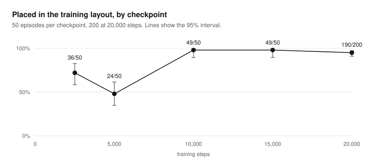
</picture>

checkpoint-5000, the dip in the chart:

| | | |
| :---: | :---: | :---: |
| 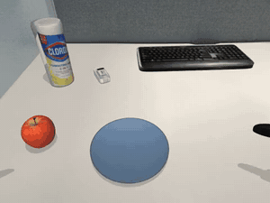 | 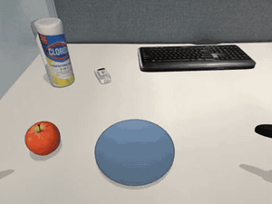 | 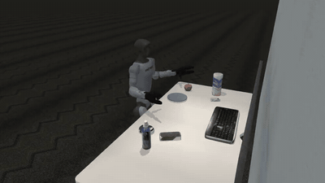 |
| Episode 0: pushes the apple, never lifts it | Episode 1: placed | Episode 0, whole scene |

## Evaluation

[Kite](https://kiteml.com) ran the policy closed-loop on the desk twin: the G1 under SONIC v1.1 in MuJoCo, seen through the robot's head camera.

- Every episode lasts 12 s. It counts as placed when the apple rests on the plate, out of the hand, for 0.5 s.
- The camera images come from the simulator's own renderer, which looks simpler than the datasets above.
- Each condition uses the same apple and plate positions as its baseline, episode by episode.

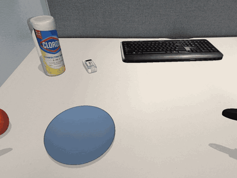

<picture>
  <source media="(prefers-color-scheme: dark)" srcset="docs/placed_by_test_dark.svg">
  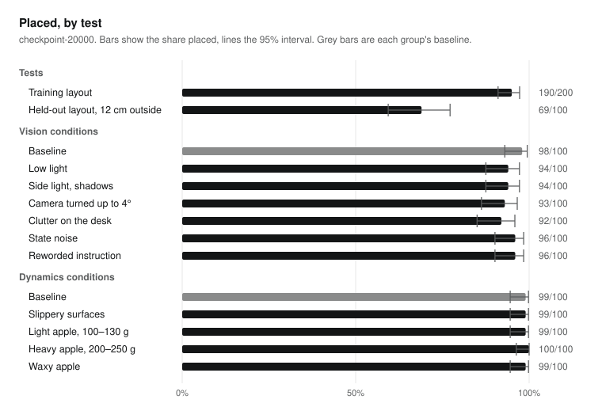
</picture>

### Training layout

| Checkpoint | Placed (95% interval) | Fell |
| --- | --- | --- |
| 2,500 | 36/50 (72%, 58–83%) | 0 |
| 5,000 | 24/50 (48%, 35–61%) | 0 |
| 10,000 | 49/50 (98%, 90–100%) | 0 |
| 15,000 | 49/50 (98%, 90–100%) | 0 |
| 20,000 | 190/200 (95%, 91–97%) | 0 |

checkpoint-20000, head camera, episodes 0 to 3, all placed:

| | |
| :---: | :---: |
|  |  |
| 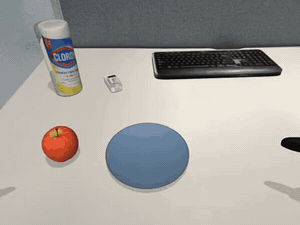 | 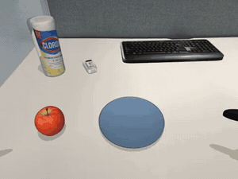 |

6 of the 10 failures. 3 lift the apple and lose it, 3 never grip it. None is a fall.

| | | |
| :---: | :---: | :---: |
| 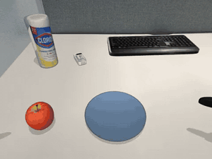 | 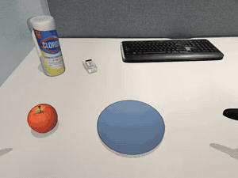 | 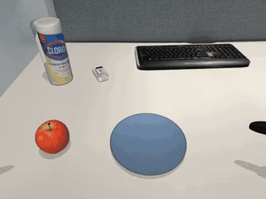 |
| Episode 17: lifts, loses it on the way to the plate | Episode 55: lifts, loses it out of view | Episode 85: drops it past the plate |
| 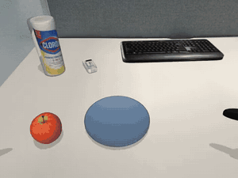 | 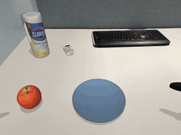 | 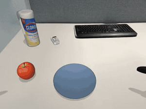 |
| Episode 52: knocks it away closing the hand | Episode 57: bumps it along the desk, no grip | Episode 70: pushes it off the desk |

Whole scene, replayed from the saved simulator state:

| | | |
| :---: | :---: | :---: |
| 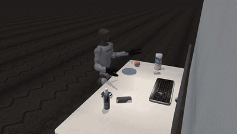 | 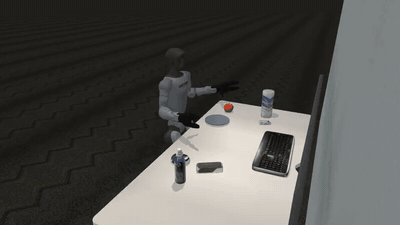 | 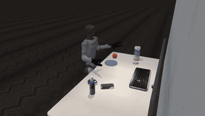 |
| Episode 0: placed | Episode 1: placed | Episode 17: released at the plate's rim, rolls off the desk |
| 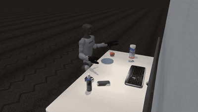 |  | |
| Episode 85: dropped behind the plate | Episode 52: knocked away | |

### Held-out layout

The apple and plate sit 12 cm to the robot's left, outside the ±8 cm the training data covered, on new episodes that played no part in any choice. This is the figure to quote, because the training data and the training-layout test come from the same desk twin.

| | Placed (95% interval) | Fell |
| --- | --- | --- |
| checkpoint-20000 | 69/100 (69%, 59–77%) | 0 |

Of the 31 misses, the hand knocks the apple away before the grasp in 23. The rest: no grip 2, missed the plate 2, placed but not held 2, dropped in transit 1, still held at the end 1. At the new positions, the approach the policy learned clips the apple. More varied apple positions in training is the obvious next step.

| | | |
| :---: | :---: | :---: |
| 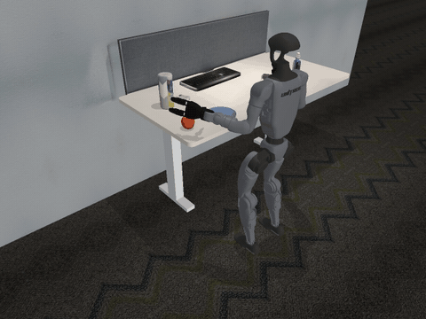 |  |  |
| Placed | Knocked away before the grasp | Knocked away before the grasp |

### Conditions

100 episodes each, paired with the baseline. The condition ranges are in [`policy/results/conditions_vision/conditions.yaml`](policy/results/conditions_vision/conditions.yaml) and [`policy/results/conditions_dynamics/conditions.yaml`](policy/results/conditions_dynamics/conditions.yaml).

| Vision | Placed | | Dynamics, within real variation | Placed |
| --- | --- | --- | --- | --- |
| baseline | 98 | | baseline | 99 |
| low light (35–60%) | 94 | | slippery surfaces (friction ×0.6–0.9) | 99 |
| side light, shadows | 94 | | light apple (100–130 g) | 99 |
| camera turned up to 4° | 93 | | heavy apple (200–250 g) | 100 |
| clutter on the desk | 92 | | waxy apple (friction 0.4–0.6) | 99 |
| state noise (σ 0.02) | 96 | | weaker and stiffer servos, joint damping, 5–30 ms motor delay | running |
| reworded instruction | 96 | | | |

No condition so far moves the policy by more than 6 points, and nothing fell. The vision conditions ran with the twin's first contact model, the dynamics ones with the corrected one below.

Lighting, head camera, on the apple and plate positions of baseline episodes 0 and 1:

| | |
| :---: | :---: |
| 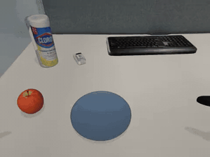 | 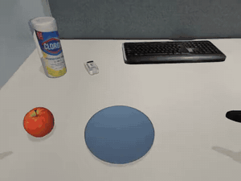 |
| Low light, episode 0: placed | Low light, episode 1: placed |
| 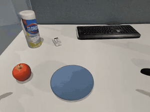 | 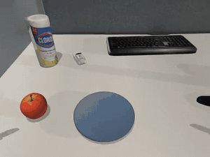 |
| Side light, episode 0: placed | Side light, episode 1: placed |

### The apple's contacts

The desk twin first used MuJoCo's default contacts (pyramidal friction cones, impratio 1). Under them, a firmly squeezed apple slides out of a grip, and a dropped one rolls about 25 cm. This may be why the datasets note that the apple lands harder and rolls further than in NVIDIA's demos (see Limits). With elliptic cones and impratio 10, as MuJoCo recommends for grasping, the same policy places 99/100 against 96/100 on the same episodes. That difference is not significant (5 discordant episodes, exact McNemar p = 0.375), so the policy does not depend on the slippery contacts.

### Within the G1's limits

Recorded commands were replayed exactly, and every motor was checked at every 5 ms physics step against Unitree's G1 URDF ([`policy/results/limits/`](policy/results/limits/), 200 episodes). No joint leaves its range, and joint speeds stay under 56% of rated. Torque briefly reaches the limit in a few episodes, for milliseconds at a time:

- the left shoulder pitch touches its 25 N·m rating in 2 of 200 episodes, and the left elbow peaks at 24 of 25 N·m;
- the waist pitch touches the simulator's 25 N·m clamp in 5 episodes, below Unitree's 35 N·m rating;
- the left middle finger reaches its 1.4 N·m in 9 episodes while squeezing the apple.

Nothing exceeds a rating, because the simulator clamps at it. But the left arm's fast reach runs those motors at their limit for an instant, at the speed of NVIDIA's teleoperated demos (wrist peak about 1 m/s). A real deployment should rate-limit the arm, which would also lower those peaks.

All the numbers in this section are in [`policy/results/SUMMARY.md`](policy/results/SUMMARY.md) and [`policy/results/summary.json`](policy/results/summary.json).

## Limits

- Simulation only. Nothing has been tested on a real robot or on NVIDIA's own SONIC deploy.
- In the datasets, only the G1, the original apple and the plate are simulated physically. The moved and added desk items, and the other apples in `types`, are visual only.
- The apple lands harder and rolls further than in NVIDIA's demos, and in some episodes it's still rolling when the episode ends. `meta/provenance.json` lists each episode's `apple_fall_cm`, `apple_roll_cm` and `apple_end_speed_cm_s`, so you can filter on them.
- The body sways more than in NVIDIA's demos, because SONIC balances the robot itself: the pelvis moves about 3.7 cm over a typical `baseline` episode, against 0.4 cm in NVIDIA's demos, and the head camera moves with it.
- The policy was trained on its own 824-episode set from this desk, not on the eight datasets, and evaluated with the simulator's renderer rather than the datasets' look.
- Four dynamics conditions are still running. This report will be updated when they finish.

## Credits

Derived from [nvidia/Arena-G1-Static-PickNPlace-Task](https://huggingface.co/datasets/nvidia/Arena-G1-Static-PickNPlace-Task) (CC-BY-4.0). Motion tokens come from NVIDIA's [SONIC v1.1](https://huggingface.co/nvidia/GEAR-SONIC) (NVIDIA Open Model License). The policy is fine-tuned from [GR00T N1.7](https://huggingface.co/nvidia/GR00T-N1.7-3B), under the NVIDIA Open Model License. Made by [Kite](https://kiteml.com).
