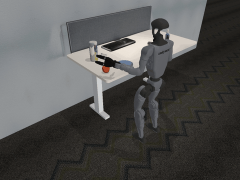
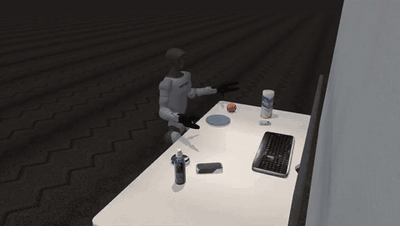
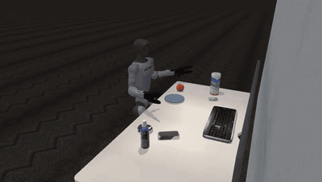

# A fine-tuned GR00T N1.7 policy on the desk, and how it scores

**Model:** [`kiteml/gr00t-n1.7-g1-sonic-desk-apple`](https://huggingface.co/kiteml/gr00t-n1.7-g1-sonic-desk-apple)
(private to the kiteml organisation). It is [nvidia/GR00T-N1.7-3B](https://huggingface.co/nvidia/GR00T-N1.7-3B)
fine-tuned for `UNITREE_G1_SONIC`: from the head camera, the robot's state and the instruction, it outputs SONIC v1.1
motion tokens and Dex3 hand targets, 40 steps (0.8 s) at a time.

**Headline:** the policy places the apple on **95%** of episodes in the layout it trained on, and on **69%** when the
apple and plate move 12 cm outside that layout. Nothing fell in any run.

| | |
|:---:|:---:|
|  |  |
| Held-out layout, placed | Held-out layout, the hand knocks the apple away before the grasp |
|  |  |
| Training layout, placed | Training layout, released at the plate's rim, rolls off the desk |

## How it was trained

- **Data:** 824 episodes (160,415 frames at 50 Hz) of the same task on this desk, with the apple and plate placed
  within ±8 cm. This is not one of the eight datasets in this repository.
- **Run:** fine-tuned from nvidia/GR00T-N1.7-3B, 20,000 steps at global batch 16 on one A100 40GB. The published
  weights are `checkpoint-20000`.

## How it was evaluated

[Kite](https://kiteml.com) ran the policy closed-loop on the desk twin: the G1 under SONIC v1.1 in MuJoCo.

- Every episode lasts 12 s. Success means the apple rests on the plate, out of the hand, for 0.5 s.
- Each condition uses the same apple and plate positions as its baseline, episode by episode.

The numbers below are in [`results/SUMMARY.md`](results/SUMMARY.md) and [`results/summary.json`](results/summary.json).

### Training layout (in-distribution)

| Checkpoint | Placed (95% CI) | Fell |
|---|---|---|
| 2,500 | 36/50 (72%, 58–83%) | 0 |
| 5,000 | 24/50 (48%, 35–61%) | 0 |
| 10,000 | 49/50 (98%, 90–100%) | 0 |
| 15,000 | 49/50 (98%, 90–100%) | 0 |
| **20,000** | **190/200 (95%, 91–97%)** | 0 |

### Held-out layout: the number to quote

The apple and plate sit 12 cm to the robot's left, outside the ±8 cm the training data covered, on new episodes
that played no part in any choice.

| | Placed (95% CI) | Fell |
|---|---|---|
| checkpoint-20000 | **69/100 (69%, 59–77%)** | 0 |

Failure types: **knocked away before the grasp 23**, no grip 2, missed plate 2, placed but not held 2, dropped in
transit 1, held at the end 1. At the new positions, the approach the policy learned clips the apple. More varied
apple positions in training is the obvious next step.

### Under conditions (100 episodes each, paired with the baseline)

| Vision | Placed | | Dynamics (within real variation) | Placed |
|---|---|---|---|---|
| baseline | 98 | | baseline | 99 |
| low light (35–60%) | 94 | | slippery surfaces (friction ×0.6–0.9) | 99 |
| side light, shadows | 94 | | light apple (100–130 g) | 99 |
| camera turned ±4° | 93 | | heavy apple (200–250 g) | 100 |
| clutter on the desk | 92 | | waxy apple (friction 0.4–0.6) | 99 |
| state noise (σ 0.02) | 96 | | weaker and stiffer servos, joint damping, 5–30 ms motor delay | *running* |
| reworded instruction | 96 | | | |

No condition so far moves the policy by more than 6 points, and nothing fell. The vision conditions ran in the twin's
first contact model; the dynamics ones in the corrected one (below).

### The apple's contacts

The desk twin first used MuJoCo's default contacts (pyramidal friction cones, impratio 1). Under them, a firmly squeezed
apple slides out of a grip, and a dropped one rolls about 25 cm. This may be why the datasets here note that "the apple
lands harder and rolls further than in NVIDIA's demos". With elliptic cones and impratio 10, as MuJoCo recommends for
grasping, the same policy places 99/100 against 96/100 on the same seeds. That difference is not significant (5
discordant episodes, exact McNemar p = 0.375): the policy does not depend on the slippery contacts.

### Within the G1's limits

Recorded commands were replayed bit-exactly, and every motor was checked at every 5 ms physics step against Unitree's
G1 URDF ([`results/limits/`](results/limits/), 200 episodes). No joint leaves its range, and joint speeds stay under
56% of rated. Torque briefly reaches the limit in a few episodes, for milliseconds at a time:

- the left shoulder pitch touches its 25 N·m rating in 2 of 200 episodes, and the left elbow peaks at 24 of 25 N·m;
- the waist pitch touches the simulator's 25 N·m clamp in 5 episodes, below Unitree's 35 N·m rating;
- the left middle finger reaches its 1.4 N·m in 9 episodes while squeezing the apple.

Nothing exceeds a rating, because the simulator clamps at it. But the left arm's fast reach runs those motors at their
limit for an instant, at the speed of NVIDIA's teleoperated demos (wrist peak about 1 m/s). A real deployment should
rate-limit the arm, which would also lower those peaks.

## Limits

- Simulation only. Nothing has been run on a real robot or on NVIDIA's own SONIC deploy.
- The training data and the in-distribution evaluation come from the same desk twin. That is why the held-out figure
  (69%) is the one to quote.
- Four dynamics cells are still running. This page will be updated when they finish.

Made by [Kite](https://kiteml.com). The model is under the NVIDIA Open Model License. It was trained on data derived
from nvidia/Arena-G1-Static-PickNPlace-Task (CC-BY-4.0).
